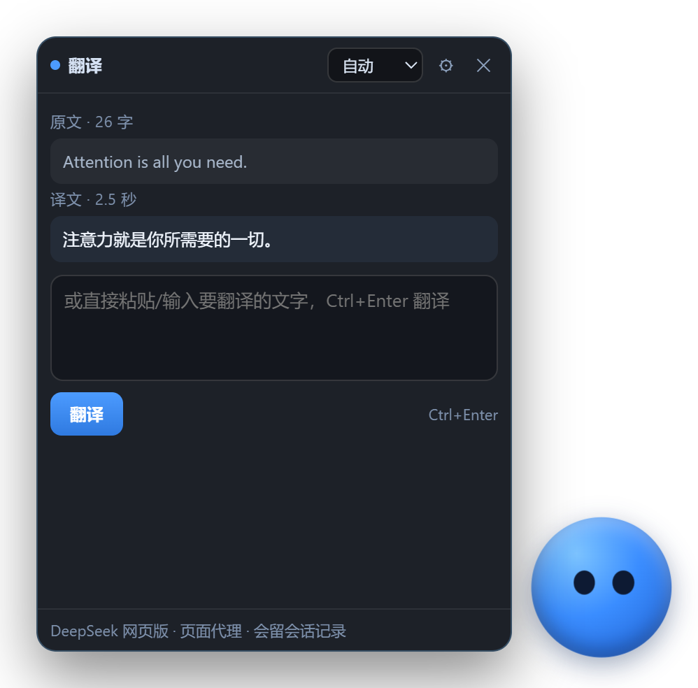

# 翻译球

Windows 上的划词翻译工具。选中文字按 `Ctrl+Alt+T`，译文出现在鼠标旁边的浮球面板里，不用切换窗口。



## 下载

**[下载翻译球 v0.1.0](https://github.com/zi-hang-huang/pet-translator-desktop/releases/download/v0.1.0/pet-translator-v0.1.0-win64.zip)** · Windows 64 位 · 139.8 MB

1. 解压到任意目录
2. 双击 `翻译球.exe`
3. 第一次使用先登录 DeepSeek

程序没有数字签名。如果 Windows 提示「已保护你的电脑」，点「更多信息」，再点「仍要运行」。

登录只要一次：打开面板，点右上角齿轮，点「打开 DeepSeek 窗口」，在弹出的窗口里登录。DeepSeek 账号免费注册。登录状态保存在本机，之后不用重复登录。

## 功能

- 在任意程序里选中文字，一个快捷键完成翻译
- 浮球始终置顶，可以拖到屏幕任何位置，大小 0.6× 到 1.8×
- 面板和球是两个独立窗口，各自记位置，可以拖到互不遮挡的地方
- 面板右下角可以拉伸，范围 260×320 到 760×900
- 译文点一下就复制
- 目标语言可选：自动、中文、English、日本語
- 面板底色、不透明度、球颜色、文字颜色都能改
- 球的眼睛跟着鼠标转
- 开机自启可选，默认关闭

## 使用

| 操作 | 效果 |
|---|---|
| 选中文字后按 `Ctrl+Alt+T` | 取词并翻译 |
| 点球 | 同样取词并翻译 |
| 拖球 | 换位置，松手后记住 |
| 托盘图标或右键球，选「打开面板」 | 打开翻译面板 |
| 拖面板标题栏 | 移动面板 |
| 拖面板右下角 | 调整面板大小 |
| `Ctrl+Enter` | 翻译输入框里的文字 |
| 点译文 | 复制 |
| `Esc` | 翻译中取消这次翻译，否则关闭面板 |

不取词也可以直接用：在面板输入框里粘贴文字，按 `Ctrl+Enter`。

单次最多 4000 字符。

## 常见问题

**第一次打开要登录？**
翻译走 DeepSeek 网页版，用的是你自己的账号。面板里点「打开 DeepSeek 窗口」登录一次即可，登录状态存在本机。

**翻译几次之后没有译文，或者只出来一两个字？**
DeepSeek 网页版对请求频率有限制。程序在两次翻译之间留了间隔，识别到回复被截断时也不会当成译文显示。遇到这种情况等十几秒再试。重启程序没有用。

**取词之后，我复制的图片或富文本没了？**
取词需要借用剪贴板，用完只能还原纯文本，原来的图片和格式无法恢复。

**窗口周围有黑边，或者整块变成黑底？**
部分显卡和远程桌面下透明窗口会这样。打开设置，勾选「关闭硬件加速」，重启程序。

**按了快捷键没反应？**
`Ctrl+Alt+T` 可能被别的软件占用了。设置页那一行会标出注册失败。

**球跑到屏幕外面找不到了？**
重新启动程序，球会回到默认位置。或者用托盘的「退出」再打开。

**怎么彻底卸载？**
先关掉开机自启，再删掉程序文件夹。设置和登录状态在 `%APPDATA%\pet-translator-desktop`，一起删掉就干净了。

**出问题想看日志？**
`%APPDATA%\pet-translator-desktop\app.log`

## 系统要求

- Windows 10 或 Windows 11，64 位
- 一个 DeepSeek 账号
- 能访问 chat.deepseek.com

## 隐私

- 不需要 API Key，翻译用的是你自己的 DeepSeek 登录状态
- 登录凭据只保存在本机，不上传到任何地方
- 不收集使用数据，取到的文字只发给 DeepSeek 用于翻译
- 想清掉本机的会话记录，用面板里的「清空翻译会话」

## 从源码构建

```powershell
npm install
npm start
```

打包成免安装目录：

```powershell
powershell -ExecutionPolicy Bypass -File scripts\pack.ps1
```

环境要求、调试命令、打包细节见 [docs/DEVELOPMENT.md](docs/DEVELOPMENT.md)。

## 更多

- [更新日志](CHANGELOG.md)
- [开发文档](docs/README.md)

## 许可

MIT
